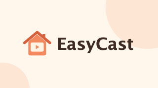
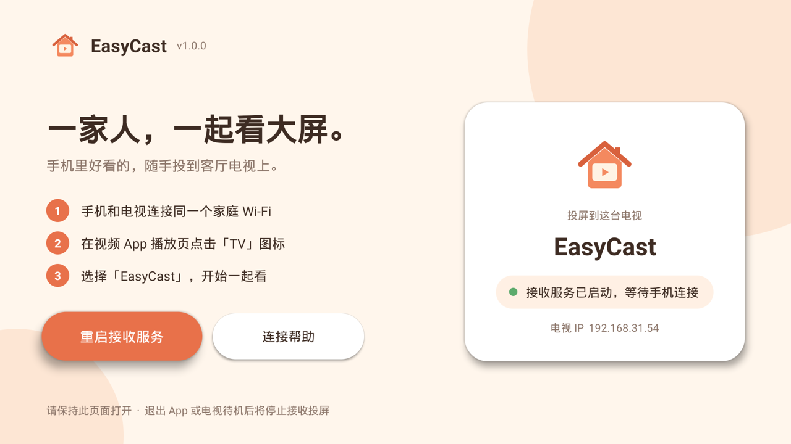

<div align="center">



**让 Android 电视变成投屏接收器，一家人一起看大屏。**

[](https://github.com/iamherrylok/easycast/releases/latest)

[](LICENSE)

[**⬇ 下载最新版 APK**](https://github.com/iamherrylok/easycast/releases/latest)

</div>



## 这是什么

EasyCast 是装在 **Android TV 电视或电视盒子**上的投屏接收端。装好后，在手机视频 App 的播放页点一下 **「TV」**，选择 **EasyCast**，视频就会在电视上播放。

## 亮点

- 🏠 **免费、无广告、不用注册**：也不收集任何使用数据。
- 📱 **手机点一下就能投**：支持手机视频 App 里常见的「TV」投屏（DLNA）。
- 🎬 **常见格式都能播**：MP4、HLS、DASH，点播和直播均可。
- 🎮 **遥控器就能用**：大字界面，播放时按返回键即可停止。
- 📺 **不挑电视品牌**：Android 8.0 及以上的电视和盒子都能装，不需要 Google 服务。

## 三步开始

1. **安装**：在 [Releases](https://github.com/iamherrylok/easycast/releases/latest) 下载 `easycast-1.0.0.apk`，装到电视上（安装方法见下方）。
2. **打开**：在电视上打开 **EasyCast**，看到“接收服务已启动，等待手机连接”即可。
3. **投屏**：手机连上和电视同一个 Wi-Fi，在视频 App 播放页点 **「TV」**，选择 **EasyCast**。

<details>
<summary><b>怎么把 APK 装到电视上？</b></summary>

- **U 盘**：把 APK 拷进 U 盘插到电视上，用电视自带的文件管理器打开安装。第一次安装时需要在设置里允许“未知来源”应用，具体菜单因电视品牌而异。
- **手机推送**：如果电视装了当贝市场、沙发管家等应用，可以用它们配套的手机助手，把 APK 推送到电视上安装。
- **ADB**（适合有电脑的用户）：

  ```sh
  adb connect 电视IP
  adb install -r easycast-1.0.0.apk
  ```

</details>

## 常见问题

<details>
<summary><b>手机搜不到 EasyCast？</b></summary>

- 确认手机和电视连的是**同一个家庭网络**，不要用访客 Wi-Fi；有的路由器开了“AP 隔离”，也会让设备互相看不见。电视用网线也可以，只要和手机的 Wi-Fi 在同一个网络里。
- **iPhone**：打开 设置 → 隐私与安全性 → 本地网络，允许你的视频 App 访问。
- 确认电视上的 EasyCast 正开着，并显示“接收服务已启动”。
- 还是不行，就在电视上点“重启接收服务”，然后在手机上重新搜索。

</details>

<details>
<summary><b>为什么投屏时 EasyCast 要一直开着？</b></summary>

当前版本只在 App 打开时接收投屏。退出、切换到其他 App 或电视待机后，接收服务会停止，再次打开就会恢复。

</details>

<details>
<summary><b>能把手机整个屏幕投上去吗？</b></summary>

暂时不行。EasyCast 接收的是视频 App 里的「TV」投屏，不支持 iPhone 控制中心的“屏幕镜像”（AirPlay），也不支持华为 Cast 等整屏镜像。

</details>

<details>
<summary><b>能连上，但视频播放失败？</b></summary>

电视上会显示失败原因。常见情况：视频有版权保护（DRM）、需要会员鉴权，或者电视解码不了这种格式。可以先换一个普通视频试试。欢迎带上**电视型号、视频 App 名称和电视上显示的错误**提交 [Issue](https://github.com/iamherrylok/easycast/issues)。

</details>

<details>
<summary><b>从旧的测试版升级时提示安装失败？</b></summary>

早期测试版使用的签名和正式版不同，需要先卸载旧版再安装。卸载后手机上可能要重新选一次 EasyCast。

</details>

## 已知限制

- 只在 App 打开时接收投屏，不支持后台常驻和开机自启。
- 不支持整屏镜像（AirPlay 镜像、华为 Cast 等）。
- 兼容性因电视和视频 App 而异，目前还没有逐一验证所有组合。
- 非 Android 系统的电视无法安装。

## 开发者

想自己编译、修改或了解实现细节，请看 [开发文档](docs/DEVELOPMENT.md)。欢迎提交 Issue 和 Pull Request。

## 许可证

[MIT](LICENSE) © 2026 iamherrylok
